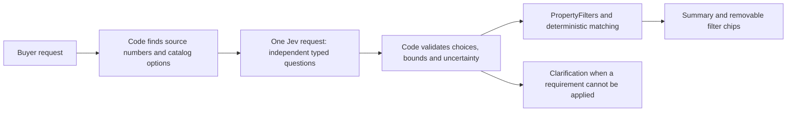

# Jev search and UX changes

Branch: `codex/ux-ui-search-improvements`, created from `origin/main`.

## Search design

The application compiles a buyer's request into the same `PropertyFilters` used by the manual controls. It combines conditions across fields with AND, and accepted alternatives within a category with OR. For example, `(House OR Townhouse) AND bathrooms >= 2 AND price <= 1800000`.



Code owns numbers and execution. Jev selects a supplied source value and identifies its lower/upper boundary, rather than generating numeric JSON. Candidates preserve compact prices (`$1.5m`), comma-separated areas, decimal values and supported number words. Equivalent numeric values share one candidate so repeated values do not split confidence. Exact bedroom/bathroom syntax and explicit commute comparisons are resolved in code, preventing an earlier “at least” from leaking across clauses.

Separate yes/no questions identify accepted property types, architectural styles, ownership types and mapped hazards. Choice questions handle general school proximity/type, enrolment-zone intent, locations, commute destinations and transport modes.

Explicit numeric years take precedence over inferred eras. “Space for four cars” sets a minimum parking capacity. Strict area comparisons retain exclusive boundaries; integer year/count bounds are adjusted by one. Strict monetary bounds are adjusted by one cent. The response summary is generated from the final filters, so parking, land/floor area, construction dates, school proximity and commute constraints remain visible.

Contradictory ranges, uncertain selected values, unsupported requirements and unavailable locations produce `needs-clarification`. The UI leaves existing filters in place while showing the clarification. The current confidence thresholds are initial values checked against this evaluation set; they are not a guarantee of accuracy for every possible phrasing.

The existing Gemini/local fallback remains available if Jev cannot be reached. The local parser also recognizes car-capacity wording. Those fallbacks do not have the same breadth of semantic interpretation as Jev. Cross-field branching such as “either a cheap apartment or a large expensive house”, excluded categories, and unsupported numeric disjunctions need clarification or separate searches. Saved-location proximity remains a separate personal control, not a listing attribute sent to Jev.

This follows TypeSafe's [pre-parsed value extraction](https://docs.typesafe.ai/cookbooks/pre_parsed_value_extraction_cookbook), [parallel questions](https://docs.typesafe.ai/patterns/fan-out) and [typed API](https://docs.typesafe.ai/api). Chaining requests is useful only when an earlier answer supplies new evidence or new choices; independent property filters can be evaluated together.

## Announced evaluation queries

These queries, including the revised cases 5, 7 and 8, were shared in chat before live testing. The live checks assert the complete filter object, a `ready` status, Jev as the source, and a matching fixture property. Replay tests also check that changing a requested numeric value makes the listing fail the combined filters. Fixture properties are deliberately constructed for coverage; live listing availability is a separate question.

1. A house in Auckland under $1.5m with enough room for 4 cars, at least 3 bedrooms and 2 bathrooms.
2. A house or townhouse in Ponsonby between $900k and $1.8m, with 3 to 4 bedrooms and at least 2 bathrooms.
3. A contemporary house built between 2005 and 2020, at least 600 m² of land and 180 m² of floor area.
4. A character villa built before 1940, exactly 4 bedrooms, at least 2 bathrooms and no mapped flood hazards.
5. A freehold house with at least 600 m² of land, 180 m² of floor area and parking for 2 cars.
6. An apartment under $850k, no more than 2 bedrooms, exactly 1 bathroom and at least 1 parking space.
7. A house near a school, with 4 or more bedrooms, at least 2 bathrooms and an open home.
8. A townhouse with a commute to Auckland CBD within 30 minutes by public transport, at least 2 bathrooms and under $1.2m.
9. A lifestyle block with at least 2,000 m² of land, floor area over 200 m², built after 1990 and space for 4 cars.
10. A house between $800k and $1.4m, capital value at least $1m, estimated weekly rent at least $800, 3 bedrooms and 2 bathrooms.

Run the live evaluation with:

```sh
node --env-file=.env.local --import=tsx scripts/evaluate-jev-search.ts
```

The configured Jev key is read from the environment. The report at `artifacts/jev-search-evaluation.json` records the results, elapsed times and token usage without credentials. Captured Jev responses in `tests/fixtures/jev-responses.json` support deterministic replay without API calls.

## UX and chatbot

Bathrooms now sit beside location, maximum price and bedrooms. Schools and architecture are expanded fieldsets inside “More filters”. The grids wrap for smaller screens. Walk-score, sunlight and facing features have been removed from search, comparison and chatbot descriptions. The comparison tray is portalled to the document body, so the animated page wrapper cannot anchor it to the bottom of the page. Clearing bathrooms removes its numeric criterion; choosing bedrooms manually replaces an AI bedroom range.

Every chat message reads the current `/properties/:id` URL and sends the property ID. The server resolves the catalog listing and adds it as a separate currently viewed property, alongside saved homes, comparisons and LIM context. Navigating away omits the ID on the next message. The current listing is also available to the local chatbot fallback.

Desktop (1280 px) and phone (390 px) checks showed no page overflow. The original request “a house with enough room for 4 cars” was also checked through the running application: Jev applied House plus parking >= 4 and returned six catalog listings.

The chosen visual matrix is integrated into the comparison dialog. Numeric maxima, including ties, receive an optional light tint controlled by a switch; table text stays at regular weight. The labels remain fixed during horizontal scrolling on phones, and the comparison tray is a compact viewport overlay.

Phone listings remain two per row, with truncated single-line addresses and locations, three feature icons, and price/Compare aligned on one line. The mobile search action switches between search, loading and clear icons. Focusing its input fades and collapses the filters, whose actions sit below the fields. Applied AI ranges and multiple property types remain visible in editable controls. The calculator and workspace tabs use compact mobile layouts; Saved Homes opens the workspace's saved tab, and note types use a General-default dropdown.

Navigation tracks the visible calculator section on both the home and property pages. The mobile Calculator link jumps directly to that page's calculator; leaving the section restores Discover.
